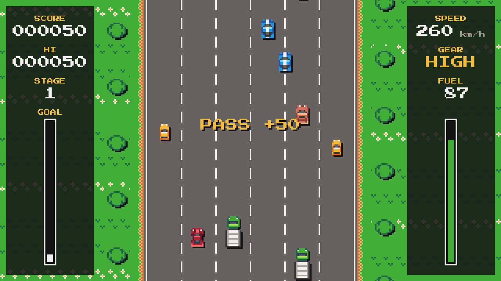
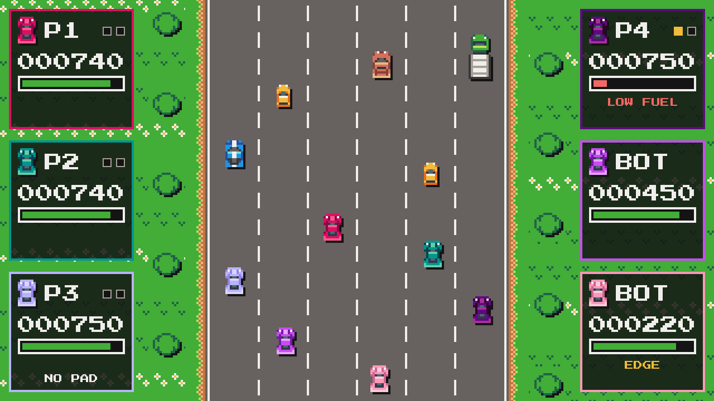

# Fuel Rivals

A top-down driving game made with Godot 4.7.2, inspired by Konami's *Road Fighter* (NES, 1985). Drive up a six-lane
road, pass the traffic, keep clear of trucks and oil, and pick up fuel cars before the tank runs dry. Pixel art from
GrafxKid's CC0 sheet, the Press Start 2P font, no sound.



## State

- **Phase A, the single-player game, is done.** The rules of the earlier Phaser prototype are ported to a pure,
  deterministic GDScript simulation and checked against traces recorded from the TypeScript version. Phase A also
  covers the scenes, the view, keyboard and gamepad input, the tests, a smoke test, a pack export check and CI.
- **Phase B, local multiplayer, is under way.** The versus mode is playable from the title's VERSUS choice: up to 6
  cars on one screen, one gamepad each, bots for the seats people leave empty, best of 3 rounds. Done: the versus
  rules, the match and the bots (B1), and the versus screens (B2): the join screen, a seat per gamepad, the six player
  colours, the race with a panel per car, the round and match results, rematch, gamepads that disconnect and come
  back. Steam Input through GodotSteam (B4) is in, not yet tried with a real Steam client (see Steam below). QA with
  six cars and the real Linux and Windows builds (B3) are done; nobody has played it with six physical gamepads or on
  Windows yet. The owner's decisions are in
  `docs/DECISIONES_MULTIJUGADOR.md`, the plan in `docs/GODOT_PLAN.md` (both in Spanish). `docs/HANDOFF.md` has each
  step's notes: files, how to verify, APIs, known gaps.
- Targets: Steam on the desktop (Linux and Windows) first, the web later.
- The Phaser prototype is no longer in the tree. It is in git at commit `0a0841f`.

## Run

You need the Godot 4.7.2 editor, the standard build (not .NET): the `Godot_v4.7.2-stable_*` downloads of the
[4.7.2-stable release](https://github.com/godotengine/godot/releases/tag/4.7.2-stable).

- **In the editor:** import `project.godot` in the Project Manager, then press F5 (Run Project).
- **From the command line**, where `godot` is the editor binary (`Godot_v4.7.2-stable_linux.x86_64` on Linux):

  ```bash
  godot --headless --path . --import   # once per clone: imports the art into .godot/
  godot --path .                       # the game
  godot --path . -- --seed=42          # the first game uses seed 42, the next ones 43, 44, ...
  ```

  Without the import the art does not load. Without `--seed` the first game's seed is random; every new game uses
  the previous seed + 1.

The window opens at 1920x1080, three times the 640x360 picture. On a smaller screen it shrinks to the largest whole
multiple that fits, such as 1280x720 on a 1366x768 screen. **F11** or **Alt+Enter**, on any screen, switches between
the window and fullscreen; the picture keeps a whole-number scale (3x on a 1920x1080 screen, with black bars where it
does not fill the screen). The game pauses when its window loses focus. The best score lasts for the session only;
nothing is saved.

## Controls

The title has two choices, **1 PLAYER** and **VERSUS**: Up and Down (arrow keys, W and S, a gamepad's D-pad or left
stick) choose, and Enter, Space, A or Start picks. A click or tap on a choice picks it too.

### 1 PLAYER

The keyboard and every connected gamepad drive the car together. Keys are bound by position (the names are QWERTY).

| Action | Keyboard | Gamepad |
|---|---|---|
| Throttle | Up, W or Z | B, D-pad up or left stick up |
| High gear, with throttle (hold) | X | A |
| Brake | Down or S | D-pad down or left stick down |
| Steer | Left and Right, or A and D | D-pad, or the left stick past half way |
| Start a game; go on after a stage clear | Enter, keypad Enter or Space | A or Start |
| Pause and resume | Esc or P | Start |
| After a game over: play again | Enter, keypad Enter or Space | A |
| After a game over: back to the title | Esc or P | Start |

Gamepad buttons are by position: A is the bottom face button, B the right one.

### VERSUS (gamepads only)

Each player has a gamepad; the keyboard drives no car. Esc goes back (it pauses a race only when no gamepad is
left, and quits a paused match), and F11 or Alt+Enter switches fullscreen. Each player's car is the colour
of their seat, which is the only way to tell players apart: P1 ruby, P2 teal, P3 lilac, P4 plum, P5 purple and P6
pink, each colour for good. No traffic car has any of them (the rainbow-coloured fuel car aside).



| When | What | Gamepad | Keyboard |
|---|---|---|---|
| Join screen | Join: take the lowest free seat and its colour | A | |
| Join screen | Leave the seat | B | |
| Join screen | Fewer or more bots (one at least with one player, six cars at most) | D-pad or stick left and right | |
| Join screen | Start the race (two cars at least) | Start | |
| Join screen | Back to the title | Back (Select, View) | Esc |
| Race | Drive | As in 1 PLAYER: B or up throttle, A high gear, down brake, D-pad or stick steers | |
| Race | Pause and resume (any player) | Start | Esc pauses |
| Paused | Quit to the title | Back | Esc |
| Round over | Next round (after one second) | A or Start | |
| Match over | Rematch: same seats, new traffic (after one second) | A or Start | |
| Match over | Back to the join screen, with the same players | B or Back | Esc |
| Any time | A gamepad that holds no seat takes the seat of a disconnected gamepad | A | |

Bots take the lowest free seats and show as BOT. When a gamepad disconnects mid-race, its bot drives
that car without stopping the round (its panel says NO PAD); the same gamepad gets it back when it reconnects, and
otherwise any gamepad that holds no seat takes it with A.

In the race each car has a panel beside the road, in its colour (P1 to P3 on the left, P4 to P6 on the right): its
points this round, its fuel, a player's rounds won (a box each; bots cannot win), and OUT (out of the round), EDGE
(touching the bottom edge of the screen, which drains fuel), LOW FUEL or NO PAD.

## Rules

The numbers come from `scripts/sim/config.gd`. Distances are in pixels of the 640x360 picture.

- **Stages.** Reach the goal: 13 500 px of road in stage 1, then 15 750, 18 000 and 20 250, then the four again. The
  GOAL gauge shows how far you are. At 400 km/h the car covers 225 px a second.
- **Gears.** High gear lasts only while X or A is held. Low gear: up to 198 km/h, gaining 70 km/h a second. High
  gear: up to 400 km/h, but it gains only 15 km/h a second below 160 km/h and 45 above. Braking takes 120 km/h a
  second, coasting 25. Above the gear's top (after letting go of high gear) the car slows by 25 km/h a second.
  Steering does nothing at a standstill and is slower at high speed.
- **Fuel.** The tank holds 100 and loses 1 a second while the game runs, moving or not. Each stage starts with a full
  tank. An empty tank ends the game. A **fuel car** (the rainbow-coloured car) gives +10 fuel (up to 100) and 1000
  points.
- **Bumps.** Touching a yellow, salmon or blue car costs nothing, but it starts a skid away from that car. Each car
  bumps you once at most.
- **Oil.** Driving onto an oil patch starts a skid to the left or the right. While skidding, steering does not move
  the car: steering into the slide stops it in a quarter of a second, steering the other way or not at all lets it go
  on. A skid into the roadside is a crash.
- **Roadside.** Touching the barrier on either side of the road is a crash: speed x 0.3 and 5 or 6 fuel lost.
- **After a bump or a crash** the car blinks for about 1.5 s. Meanwhile cars, trucks and the roadside cannot touch it;
  oil and fuel cars still can.
- **Trucks.** Touching one ends the game.
- **Points.** +50 for each car or truck you pass, +1000 for each fuel car, and at a stage clear +30 for each whole unit
  of fuel left.
- **Traffic.** New cars are small yellow cars (60 %, 80 to 120 km/h, they keep to their lane), salmon cars (20 %, 90
  to 110 km/h, one lane change), blue cars (10 %, 100 to 130 km/h, two or three lane changes, towards your lane when
  you are close) and trucks (10 %, 60 km/h). Lane changes go to a neighbouring lane only. In stage 1 a new car comes
  every 98 px of road, a fuel car (90 km/h) about every 4 500 px and an oil patch about every 1 125 px. Each stage
  spaces them 0.9 times as far apart as the stage before (the car gap stops at 56 px), so the road gets busier.
- The game ends as soon as the tank is empty or a truck is hit. If that happens in the step that reaches the goal,
  the game over wins.

The simulation (`scripts/sim/`) is pure and deterministic: the same seed and the same inputs give the same game, bit
for bit. It reads one input byte per seat per step of 1/60 s, which is what local multiplayer and, later, online
play build on.

## Tests and tools

Set `GODOT` to the editor binary. Each command imports the project first, so it works on a fresh clone, and fails on
any line of Godot's output that starts with `ERROR:` or `SCRIPT ERROR:` (WARNING lines do not count). Exit code 0
means a pass; the header of each script lists its other exit codes.

```bash
export GODOT=/path/to/Godot_v4.7.2-stable_linux.x86_64

tools/test.sh                   # every test, headless; ends with "N passed, 0 failed"
tools/test.sh --only=test_fuel  # the tests whose id (tests/test_x.gd::test_y) contains a pattern; comma-separated
tools/run_tool.sh smoke         # 10 800 frames with keyboard and gamepad events, then a versus match played with
                                # synthetic gamepads; each ends with "smoke: PASS"
tools/run_tool.sh screenshots   # the pictures in docs/screenshots/, the versus race checked by its pixels (xvfb-run)
tools/run_tool.sh scalecheck    # whole-number scaling, in five windows (needs xvfb-run)
tools/export_check.sh           # exports build/fuel_rivals.pck and runs its self test; ends with "export_check: PASS"
tools/run_tool.sh versus_qa     # versus QA through the real screens: one person and five bots, then six people's
                                # seats driven by bots over 20 seeds (about 20 minutes); ends with "versus_qa: PASS"
tools/export_builds.sh          # the four release builds in build/, checked; ends with "export_builds: PASS"
```

- `--selftest` (after `--`, also in an exported game) boots, plays 600 steps through the real screens with a
  scripted input, checks pause and resume and that a replay gives the same game, then plays a 600-step versus race
  through the join and race screens (two synthetic gamepads and a bot: pause, a gamepad that disconnects, the end of a
  round), draws 210 frames (a game, the join screen, a race) and quits with 0 or 1:
  `"$GODOT" --headless --path . -- --selftest` prints
  `selftest: ok (600 ticks checked, 600 versus ticks checked, 210 frames drawn)`. It starts from seed 1 unless
  `--seed=N` is given.
- The tests use their own runner, `tests/run_tests.gd`, with GUT-style asserts (`tests/test_case.gd`).
  `tests/PARITY.md` maps each rule test of the Phaser version to its GDScript test, or gives the reason it was
  dropped.
- **CI** (`.github/workflows/ci.yml`) runs on every push and pull request: it downloads the official Godot 4.7.2
  editor, checks it against the release's `SHA512-SUMS.txt`, caches it, runs `tools/test.sh`,
  `tools/run_tool.sh smoke` and `tools/export_check.sh`, and keeps the pack as an artifact; then the versus QA with one
  person and five bots (`tools/run_tool.sh versus_qa --scenario=lone`) and the four release builds
  (`tools/export_builds.sh`, with the export templates cached).

## Export

`export_presets.cfg` has four presets. **Linux** and **Windows Desktop** embed the pack in the binary, leave out
`tests/`, `tools/` and `docs/`, include the font's licence (`assets/font/OFL.txt`) and write to
`build/linux/fuel_rivals.x86_64` and `build/windows/fuel_rivals.exe`. They are the builds without Steam: they also
leave out `addons/godotsteam/`. **Linux Steam** and **Windows Steam** are the same with GodotSteam in, written to
`build/linux_steam/` and `build/windows_steam/`; a Steam build also needs the `steam_input/` folder copied next to
the executable (`docs/STEAM_INPUT.md`). Godot writes this file itself when presets are edited in Project > Export, so
edit them there.

A pack needs no export templates:

```bash
mkdir -p build
"$GODOT" --headless --path . --export-pack "Linux" build/fuel_rivals.pck
"$GODOT" --main-pack build/fuel_rivals.pck   # the game, from the pack
```

`--export-pack` does not create a missing folder, hence the `mkdir`. `tools/export_check.sh` does both, checks what
the pack holds and runs its self test.

Binaries need Godot's 4.7.2 export templates. `tools/fetch_templates.py` installs the four files the builds use (about
175 MB, read out of the official 1.28 GB templates file with HTTP range requests and checked by CRC-32), and
`tools/export_builds.sh` builds all four presets into `build/` (installing the templates first if needed):

```bash
tools/export_builds.sh   # build/linux, build/windows, build/linux_steam, build/windows_steam
```

Next to each executable it copies `OFL.txt` and `ASSETS.md`; next to the Steam builds also `steam_input/` and
`godotsteam_license.md` (GodotSteam copies its libraries there itself). It then runs each Linux build's self test from
an empty folder and checks that the Windows files are PE32+ x86-64 (they are not run here). A Steam depot must never
hold a `steam_appid.txt`.

## Layout

```
project.godot        engine settings: 640x360, whole-number scaling, nearest filtering, no audio
export_presets.cfg   the Linux and Windows Desktop presets, and their Steam builds
icon.svg
addons/godotsteam/   GodotSteam (Steam builds only)
steam_input/         the Steam Input action manifest and default layouts (next to the executable in Steam builds)
assets/              sprites.png and sprites.json (the atlas), font/ (Press Start 2P and its OFL.txt),
                     source/ (the original sheet; Godot ignores it)
scenes/              boot.tscn (main scene), title.tscn, game.tscn; join.tscn and versus.tscn (versus)
scripts/
  sim/               the rules: config, rng, car, fuel, traffic, collision, player_input, world, match, bot (no nodes)
  input/             keyboard (input map built in code), pads (read per device), held, local_input (1 player),
                     seats (versus: a seat per gamepad), nav (menu commands), steam_input (Steam's controllers)
  view/              atlas, pixel_art, draw, road, cars, hud, title_view, view_config; join_view, versus_hud,
                     player_colours (versus)
  app/               app (boot, fixed step, focus pause, screens, fullscreen, --selftest), fixed_step, title, game;
                     join and versus (versus)
tests/               run_tests.gd, test_case.gd, test_*.gd, sim_helpers.gd, screen_helpers.gd, race_picture.gd,
                     fake_steam.gd, PARITY.md, golden/
tools/               test.sh, run_tool.sh, export_check.sh, export_builds.sh, fetch_templates.py; smoke.gd,
                     screenshots.gd, scalecheck.gd, versus_qa.gd, bot_stats.gd, versus_golden.gd, tool_base.gd;
                     slice-sheet.py and fetch_assets.py (the atlas); gen_golden/ (the TypeScript golden traces);
                     gen_steam_input.py (the files in steam_input/)
docs/                GODOT_PLAN.md, DECISIONES_MULTIJUGADOR.md, HANDOFF.md, STEAM_INPUT.md, PLAN.md and ART_PLAN.md
                     (the Phaser prototype's plans), screenshots/
.github/workflows/   ci.yml
ASSETS.md            every shipped asset, its source and licence
```

## Assets and licences

- Sprites: GrafxKid's "Top-down arcade racing game" sheet, CC0, cut into the atlas by `tools/slice-sheet.py`. The
  truck and the oil puddle are drawn in code from pixel grids (`scripts/view/pixel_art.gd`), the project's own work.
- Font: Press Start 2P, SIL Open Font License 1.1. Its licence, `assets/font/OFL.txt`, ships in the exports with the
  font.
- No audio: the audio driver is Dummy and the game has no sound files.

`ASSETS.md` lists every shipped file with its source, author and licence, and how to rebuild the atlas;
`tests/test_assets.gd` fails if a file under `assets/` is missing from it.

## Steam

- **Steam Input** (B4, `docs/STEAM_INPUT.md`): when the game runs under Steam, every controller Steam sees (up to 16,
  of any make, Remote Play Together guests' too) is read through the action manifest in `steam_input/` and plays as a
  gamepad, so 5 and 6 gamepads work. GodotSteam 4.23.1 (`addons/godotsteam/`, MIT; Valve's Steam API library under
  the Steamworks SDK terms, `ASSETS.md`) does the talking to Steam.
- Without a Steam client, or in a build without GodotSteam, the game prints one warning ("Steam Input is off") and
  reads the gamepads itself, as without Steam. `--no-steam` (also in Steam's launch options) turns Steam Input off.
- Development uses the Steam App ID **480** (Spacewar, Valve's test app) until the game has its own.
- Not tested yet: a real Steam client, physical gamepads (six, or any), Remote Play Together, Windows.
  `docs/STEAM_INPUT.md` says how to test with App ID 480 on a PC with Steam.
- On a PC with Steam, `tools/test.sh` starts it once, as Spacewar (one test checks the real GodotSteam);
  `tools/test.sh --no-steam` leaves it alone. The tools of `tools/run_tool.sh` never start it.
- The name "Fuel Rivals" still has to be checked as a trademark before publishing.
